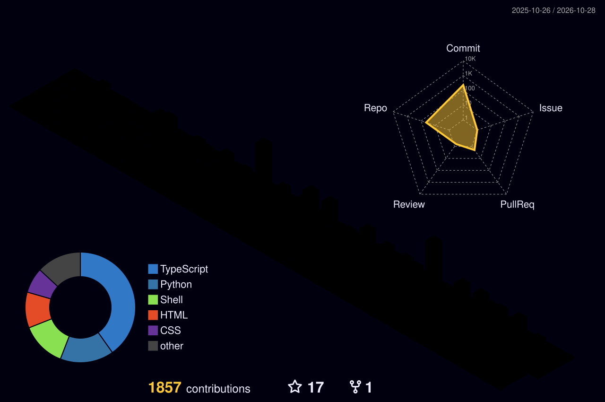

# Lívia Mor

**Full Stack Software Developer · Back-end · AWS Cloud · Cybersecurity Aspirant**

*Leader @ AWS Women User Group Goiânia · Founder @ LIFE IA*

---

## Sobre Mim

Sou **Desenvolvedora Full Stack e Back-end** com um histórico sólido de mais de 16 anos atuando como Cirurgiã-Dentista e Ortodontista. Essa vivência profunda no ecossistema de saúde me permite enxergar além do código: eu traduzo gargalos clínicos complexos em **arquiteturas de software limpas, seguras e eficientes**. Tenho forte atuação no ecossistema Cloud (AWS), integrações de Inteligência Artificial e possuo grande foco em **cibersegurança** e proteção de dados sensíveis.

Atualmente, aplico minha visão estratégica como fundadora da **LIFE IA**, um sistema que aplica IA Generativa para a regulação autônoma de leitos hospitalares no SUS.

> *"I don't just code for healthcare. I lived it on the frontlines for 16+ years."*

---

## Diferenciais de Entrega (Value Proposition)

| Capacidade | Impacto no Time |
| :--- | :--- |
| **Health Tech Domain** | Vivência clínica real. Tradução ágil de regras de negócio em soluções de tecnologia em saúde. |
| **AI, Cloud & Serverless** | Construção de arquiteturas robustas em AWS (Lambda, SQS, DynamoDB) e pipelines com AWS Bedrock. |
| **Cybersecurity (AppSec)** | Foco ativo em arquiteturas defensivas, conformidade com a LGPD e fundamentos de Pentest. |
| **Community Leadership** | Líder do AWS Women User Group Goiânia, conectando o ecossistema cloud local. |

---

## Portfólio & Experiência Prática

### LIFE IA Regulação Autônoma — Founder & Lead Developer
> Sistema inteligente open-source com IA para **automatizar a gestão de leitos hospitalares no SUS**. Propriedade Intelectual registrada no INPI.
- **Stacks:** `FastAPI` · `Python` · `React Native` · `Llama` · `BioBERT` · `AWS Bedrock`

### SecretarIA — Serverless AI Agent
> Agente de recepção automatizado para clínicas odontológicas via WhatsApp. Apresentado no AWS Community Day Sudeste Brasil.
- **Stacks:** `NestJS` · `AWS Lambda` · `Amazon SQS` · `DynamoDB` · `Amazon Bedrock`

### NineHealth — Clinic Management Platform
> Plataforma de gestão inteligente para clínicas, baseada em arquitetura de microsserviços para otimização de fluxos operacionais.
- **Stacks:** `Java` · `Spring Boot` · `React` · `Docker` · `Microservices`

### CcRoad — Social Network for Motorcyclists
> Aplicação móvel voltada para motociclistas com rastreamento GPS em tempo real e compartilhamento de rotas ao vivo.
- **Stacks:** `React Native` · `NestJS` · `Mapbox`

### IoT Healthcare Monitoring
> Hardware e software integrados para monitoramento ambiental de salas clínicas via sensores.
- **Stacks:** `Arduino (C++)` · `Java` · `JSerialComm`

---

## Skills & Ecosystem

### **Artificial Intelligence & Data Science**

  
  
  
  
  

### **Linguagens, Frameworks & Data**

  
  
  
  
  
  
  
  

### **Mobile, Mapping & IoT**

  
  
  
  
  
  
  

### **Cloud, AI, DevOps & CI/CD**

  
  
  
  
  
  
  

### **Databases, BaaS & HealthTech**

  
  
  
  
  

---

## Estatísticas & Contribuições 3D

  
  

    

  <table border="0">
    <tr>
      <td align="center" width="50%">
        
      </td>
      <td align="center" width="50%">
        
      </td>
    </tr>
  </table>

  

---

### Vamos construir algo extraordinário juntos?
Conecte-se comigo para trocar ideias sobre **Cloud, HealthTech, Inteligência Artificial** ou oportunidades de Engenharia de Software.

*"Transforming healthcare with intelligent, secure, and human-centered systems."*

